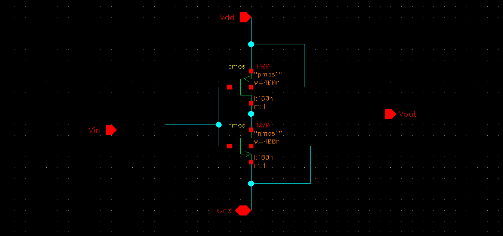
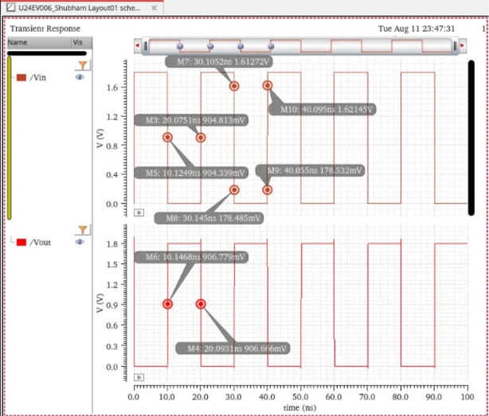
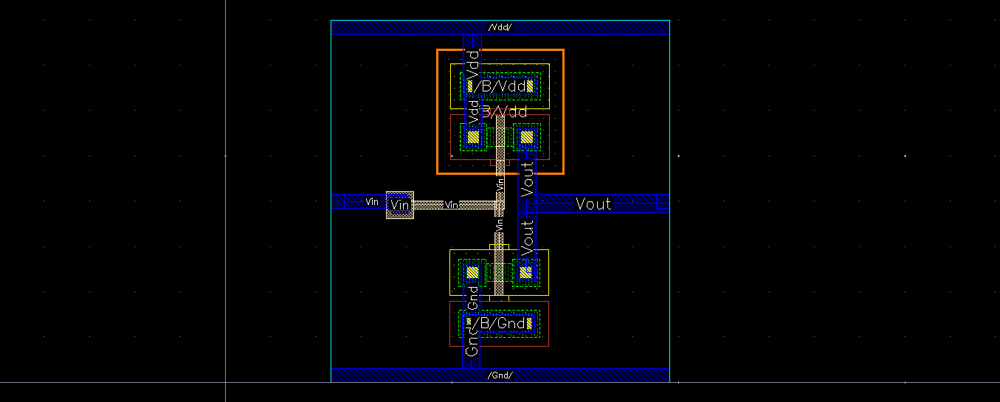

# Static CMOS Inverter | GPDK 180 nm

Design, simulation, and physical verification of a **Static CMOS Inverter** using **Cadence Virtuoso** with the **GPDK 180 nm CMOS technology**.

The experiment includes transient analysis, propagation delay measurement, physical layout verification, and pre-layout vs. post-layout performance comparison.

## 1. Design Specifications

| Parameter | Value |
|:---|:---|
| Technology | GPDK 180 nm CMOS |
| EDA Tool | Cadence Virtuoso IC618 |
| Simulator | Cadence Spectre |
| Supply Voltage (VDD) | 1.8 V |
| Input Voltage Range | 0–1.8 V |
| NMOS (W/L) | 400 nm / 180 nm |
| PMOS (W/L) | 400 nm / 180 nm |

### Circuit Schematic

## 2. Simulation Results

### Transient Analysis

Pre-layout transient response showing the input and output waveforms of the CMOS inverter.

### Propagation Delay

Propagation delays are measured at the **50% VDD crossing point (0.9 V)**.

**Average Propagation Delay:**

$$
t_p = \frac{t_{PHL} + t_{PLH}}{2}
$$

## 3. Physical Layout & Verification

The CMOS inverter layout was implemented using GPDK 180 nm technology design rules.

### Layout

### Verification Results

| Verification | Result |
|:---|:---|
| Design Rule Check (DRC) | ✅ Passed |
| Layout Versus Schematic (LVS) | ✅ Passed |
| Parasitic Extraction (PEX) | ✅ Completed |

## 4. Performance Comparison

| Parameter | Pre-Layout | Post-Layout |
|:---|---:|---:|
| tPHL (ps) | 21.9 | 15.0 |
| tPLH (ps) | 28.0 | 33.9 |
| Average Propagation Delay (ps) | 24.95 | 24.45 |
| Rise Time (ps) | 34.0 | 50.4 |
| Fall Time (ps) | 18.0 | 20.602 |

## 5. Key Observations

- **Propagation Delay:** Post-layout tPHL decreased from 21.9 ps to 15.0 ps, while tPLH increased from 28.0 ps to 33.9 ps.
- **Average Delay:** Average propagation delay remained nearly unchanged (24.95 ps pre-layout vs. 24.45 ps post-layout).
- **Rise/Fall Time:** Post-layout rise time increased by approximately 48.2%, while fall time increased by approximately 14.5%.
- **Physical Verification:** The layout successfully passed DRC and LVS verification, and parasitic extraction was completed.

---

**Tools:** Cadence Virtuoso | Spectre | Assura | Quantus

**Technology:** GPDK 180 nm CMOS
