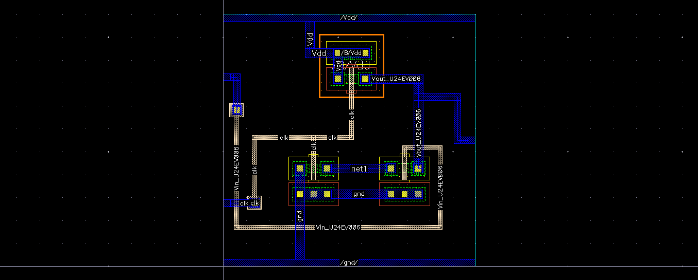

# Dynamic CMOS Inverter | GPDK 180 nm

Design, simulation, and physical verification of a **Dynamic CMOS Inverter** using **Cadence Virtuoso** in GPDK 180 nm technology.

## 1. Design Specifications

| Parameter | Value |
|:---|:---|
| Technology | GPDK 180 nm CMOS |
| EDA Tool | Cadence Virtuoso IC618 |
| Simulator | Cadence Spectre |
| Supply Voltage | 1.8 V |
| Clock Frequency | 50 MHz |
| NMOS (W/L) | 400 nm / 180 nm |
| PMOS (W/L) | 400 nm / 180 nm |

## 2. Circuit Schematic

## 3. Physical Layout

## 4. Physical Verification

| Verification | Result |
|:---|:---|
| Design Rule Check (DRC) | ✅ Passed |
| Layout Versus Schematic (LVS) | ✅ Passed |
| Parasitic Extraction (PEX) | ✅ Completed |

## 5. Performance Comparison

| Parameter | Before PEX | After PEX |
|:---|---:|---:|
| tPHL (ps) | 56.0 | 79.2 |
| tPLH (ps) | 23.59 | 29.31 |
| Average Propagation Delay (ps) | 39.80 | 54.26 |
| Rise Time (ps) | 23.6 | 118.0 |
| Fall Time (ps) | 77.4 | 41.0 |

**Average Propagation Delay:**

$$
t_p = \frac{t_{PHL}+t_{PLH}}{2}
$$

## 6. Key Observations

- Average propagation delay increased from **39.80 ps to 54.26 ps** after parasitic extraction (**36.3% increase**).
- Rise time increased from **23.6 ps to 118.0 ps**.
- Fall time decreased from **77.4 ps to 41.0 ps**.
- The physical layout successfully passed DRC and LVS verification.

---

**Tools:** Cadence Virtuoso | Spectre | Assura | Quantus

**Technology:** GPDK 180 nm CMOS
