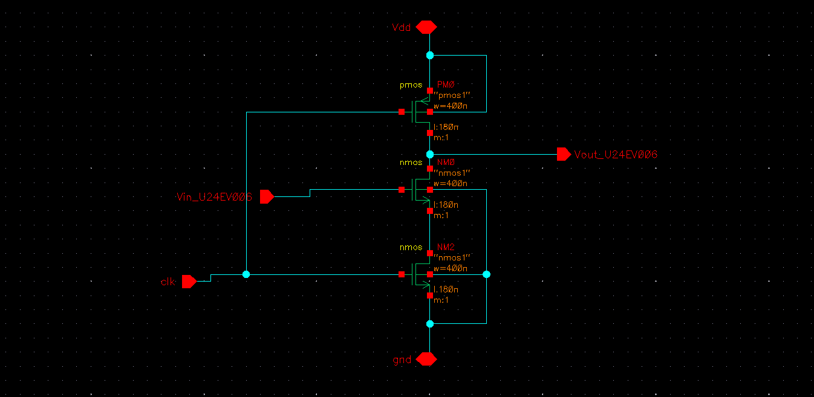
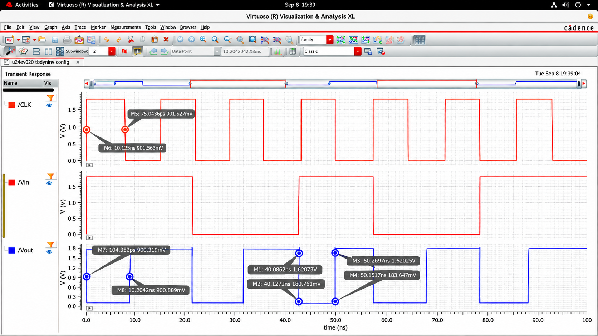

# Dynamic CMOS Inverter | GPDK 180 nm

Design, simulation, and physical verification of a **Dynamic CMOS Inverter** using **Cadence Virtuoso** with **GPDK 180 nm CMOS technology**.

The experiment focuses on precharge/evaluation operation, transient analysis, physical layout verification, and timing performance before and after parasitic extraction.

## 1. Design Specifications

| Parameter | Value |
|:---|:---|
| Technology | GPDK 180 nm CMOS |
| EDA Tool | Cadence Virtuoso IC618 |
| Simulator | Cadence Spectre |
| Supply Voltage (VDD) | 1.8 V |
| Input Voltage Range | 0–1.8 V |
| Clock Frequency | 50 MHz |
| Clock Period | 20 ns |
| NMOS (W/L) | 400 nm / 180 nm |
| PMOS (W/L) | 400 nm / 180 nm |

### Circuit Schematic

## 2. Simulation Results

### Transient Analysis

Transient response demonstrating the precharge and evaluation phases of the dynamic CMOS inverter.

### Propagation Delay

Propagation delays are measured using the **50% VDD reference (0.9 V)**.

**Average Propagation Delay:**

$$
t_p = \frac{t_{PHL}+t_{PLH}}{2}
$$

## 3. Physical Layout & Verification

The dynamic CMOS inverter layout was implemented using GPDK 180 nm technology design rules.

### Layout

[View Physical Layout](Layout/)

### Verification Results

| Verification | Result |
|:---|:---|
| Design Rule Check (DRC) | ✅ Passed |
| Layout Versus Schematic (LVS) | ✅ Passed |
| Parasitic Extraction (PEX) | ✅ Completed |

## 4. Performance Comparison

| Parameter | Before PEX | After PEX |
|:---|---:|---:|
| tPHL (ps) | 56.0 | 79.2 |
| tPLH (ps) | 23.59 | 29.31 |
| Average Propagation Delay (ps) | 39.80 | 54.26 |
| Rise Time (ps) | 23.6 | 118.0 |
| Fall Time (ps) | 77.4 | 41.0 |

## 5. Key Observations

- **Propagation Delay:** Average propagation delay increased from 39.80 ps to 54.26 ps after PEX, representing a **36.3% increase**.
- **Rise Time:** Increased from 23.6 ps to 118.0 ps after parasitic extraction.
- **Fall Time:** Decreased from 77.4 ps to 41.0 ps after parasitic extraction.
- **Physical Verification:** The layout successfully passed DRC and LVS verification, followed by successful parasitic extraction.

---

**Tools:** Cadence Virtuoso | Spectre | Assura | Quantus

**Technology:** GPDK 180 nm CMOS