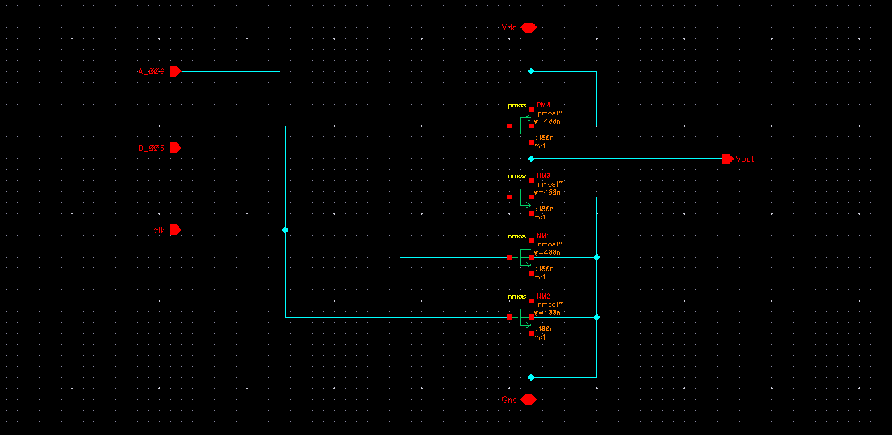
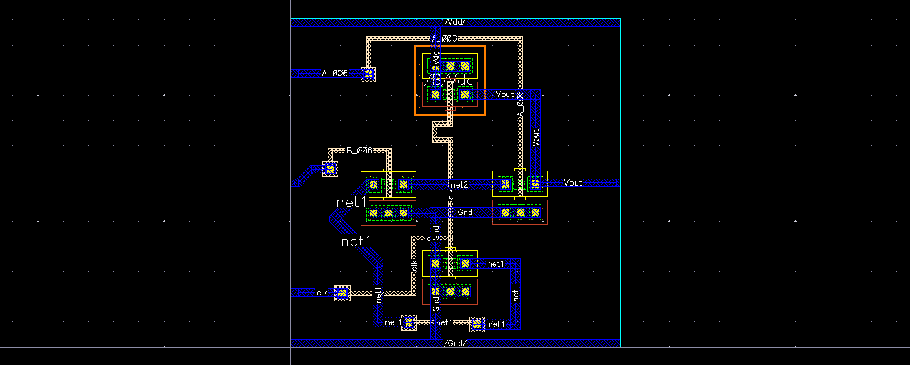

# Dynamic CMOS NAND2 Gate | GPDK 180 nm

Design, simulation, and physical verification of a **2-Input Dynamic CMOS NAND Gate** using **Cadence Virtuoso** with **GPDK 180 nm CMOS technology**.

The experiment focuses on precharge/evaluation operation, noise margin characterization, physical layout verification, and timing performance before and after parasitic extraction.

## 1. Design Specifications

| Parameter | Value |
|:---|:---|
| Technology | GPDK 180 nm CMOS |
| EDA Tool | Cadence Virtuoso IC618 |
| Simulator | Cadence Spectre |
| Supply Voltage (VDD) | 1.8 V |
| Input Voltage Range | 0–1.8 V |
| Clock Frequency | 50 MHz |
| Clock Period | 20 ns |
| NMOS (W/L) | 400 nm / 180 nm |
| PMOS (W/L) | 400 nm / 180 nm |

### Circuit Schematic

## 2. Noise Margin Analysis

Noise margins were evaluated to characterize the voltage tolerance of the Dynamic CMOS NAND2 gate under the applied simulation conditions.

| Parameter | Value |
|:---|---:|
| Output High Voltage (VOH) | 1.8 V |
| Output Low Voltage (VOL) | 0 V |
| Input High Threshold (VIH) | 846.93 mV |
| Input Low Threshold (VIL) | 557.951 mV |
| Switching Threshold (VM) | 718.116 mV |
| High Noise Margin (NMH) | 953.1 mV |
| Low Noise Margin (NML) | 558 mV |

**Noise Margin Equations:**

$$
NM_H = V_{OH} - V_{IH}
$$

$$
NM_L = V_{IL} - V_{OL}
$$

## 3. Physical Layout & Verification

The Dynamic CMOS NAND2 layout was implemented using GPDK 180 nm technology design rules.

### Layout

### Verification Results

| Verification | Result |
|:---|:---|
| Design Rule Check (DRC) | ✅ Passed |
| Layout Versus Schematic (LVS) | ✅ Passed |
| Parasitic Extraction (PEX) | ✅ Completed |

## 4. Performance Comparison

| Parameter | Before PEX | After PEX |
|:---|---:|---:|
| tPHL (ps) | 19.5 | 33.0 |
| tPLH (ps) | 78.2 | 114.5 |
| Average Propagation Delay (ps) | 48.8 | 73.7 |
| Rise Time (ps) | 107.77 | 172.0 |
| Fall Time (ps) | 38.6 | 70.2 |

## 5. Key Observations

- **Dynamic Operation:** The output is precharged HIGH and conditionally discharged during evaluation when both inputs are HIGH.
- **Propagation Delay:** Average propagation delay increased from 48.8 ps to 73.7 ps after parasitic extraction, representing an approximately **51.0% increase**.
- **Rise/Fall Time:** Rise time increased from 107.77 ps to 172.0 ps, while fall time increased from 38.6 ps to 70.2 ps after parasitic extraction.
- **Noise Margins:** The reported high and low noise margins are 953.1 mV and 558 mV, respectively.
- **Physical Verification:** The layout successfully passed DRC and LVS verification, followed by successful parasitic extraction.

---

**Tools:** Cadence Virtuoso | Spectre | Assura | Quantus

**Technology:** GPDK 180 nm CMOS
